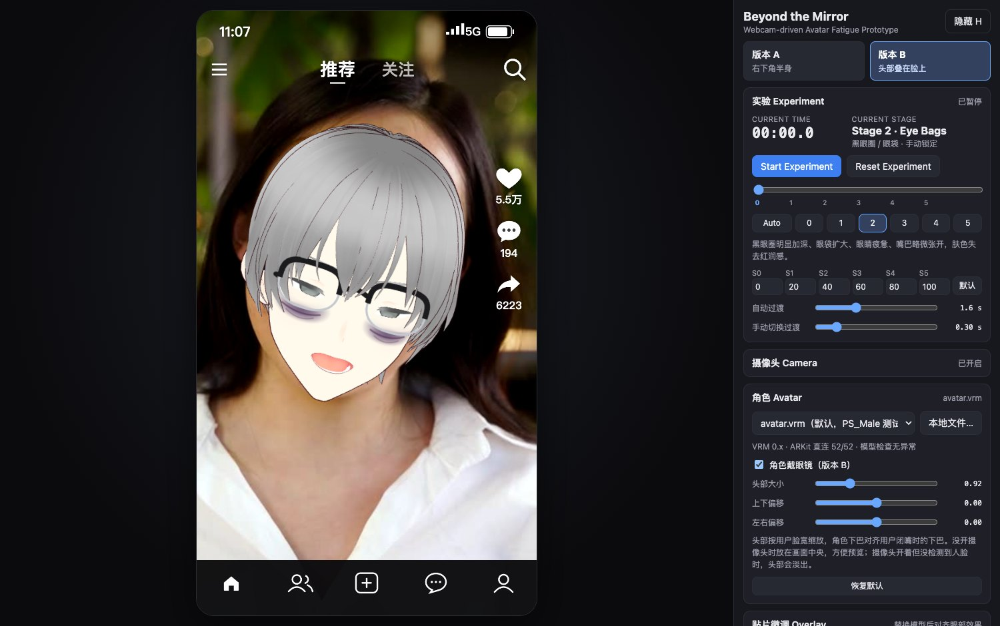
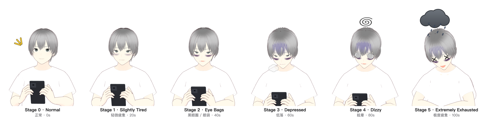
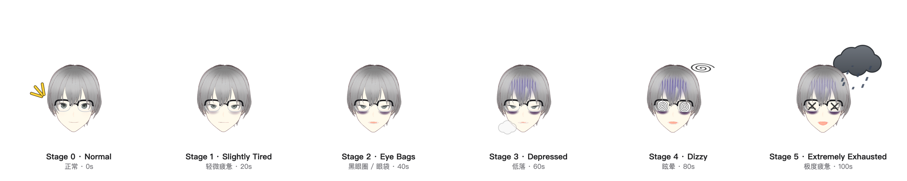

# Beyond the Mirror · 网页端 Avatar 疲惫原型

用户授权摄像头后，网页用 MediaPipe Face Landmarker 实时捕捉面部，驱动一个 3D 角色。实验计时推进时，角色按 Stage 0–5 逐级出现眼皮下垂、黑眼圈、灰化、眩晕、虚弱等变化。面捕和疲惫效果分开计算，最后叠加到同一个角色上。疲惫阶段再高，用户眨眼、张嘴、转头，角色照样会跟着做。

本原型用于 Research through Design / Poster 研究，不做任何疲劳检测，疲惫状态只由实验计时器决定。



## 实验条件

| 条件 | 右下角小窗 |
|---|---|
| A · 短视频 + Avatar | 面捕驱动的半身 Avatar，从 Stage 0 起双手举着手机。 |
| B · Self + Avatar | 用户的摄像头画面和贴在脸上的 Avatar 头部。头部随人脸移动，贴脸大小和偏移可调。 |
| C · Self Only | 用户的摄像头画面。 |

三组使用同一套 9:16 短视频和同一小窗位置。B、C 组共用摄像头构图。用面板顶部的条件按钮切换，浏览器会记住上次保存的条件。

## 运行

需要 Node.js 20 或更新版本，浏览器建议用桌面版 Chrome 或 Edge。

双击启动：macOS 双击 `启动原型.command`，Windows 双击 `启动原型.bat`。第一次运行会自动安装依赖（1–3 分钟），之后浏览器自动打开 http://localhost:5173 。macOS 如果提示“无法验证开发者”，在 Finder 里右键该文件选“打开”。

命令行：

```bash
npm install
npm run dev          # 打开 http://localhost:5173
```

摄像头只能在 localhost 或 HTTPS 页面里使用。想用手机打开，运行 `npm run dev:lan`，手机和电脑连同一个 Wi-Fi，访问终端里显示的 `https://<电脑局域网 IP>:5173`。这时用的是自签名证书，手机浏览器会提示不安全，选择继续访问即可。

| 命令 | 作用 |
|---|---|
| `npm run dev` | 本地开发服务器（改代码后页面自动刷新） |
| `npm run dev:lan` | 局域网 HTTPS，给手机访问 |
| `npm run build` / `npm run preview` | 打包到 `dist/` 并本地预览 |
| `npm test` | 单元测试 |
| `npm run check:e2e -- --video 人脸视频.mjpeg` | 自动打开页面，用模拟摄像头检查三组画面和调参流程。 |
| `npm run inspect-model -- 模型.vrm` | 命令行检查模型的骨骼、表情和授权字段 |
| `npm run setup-assets` | 重新准备 MediaPipe 的 WASM 和模型文件 |

MediaPipe 文件（`public/mediapipe/`）、测试模型（`public/models/`）和短视频（`Videos/`）都从本站加载。

## 画面

打开网页时会预先缓存 `Videos/` 里的 8 条短视频，共约 32 MB。等全部就绪后，按文件名 1 到 8 排列并自动播放第一条。缓存失败时可重试，已经下载的文件会保留。支持 Cache Storage 的浏览器会在同一网站的下次访问中复用缓存。

手机在主画面上下滑动，电脑用滚轮切换。当前视频默认静音循环，切换实验条件时会保留当前播放位置。点击主画面左上方或设置预览中的“开启摄像头”，即可使用人脸追踪或真人画面。

## 实验前后调参

1. 电脑点“实验设置与实时预览”。手机长按主画面左上角约 0.7 秒。计时中打开时可先结束本轮，或返回继续计时。
2. 选择 A 组可直接看着 Avatar 调整构图。选择 B 组后，开启摄像头并看向镜头，在默认放大的小窗里调整“贴脸大小”和左右、上下偏移。贴脸大小范围为 60%–300%，恢复默认会设为 125%。
3. 用“全画面”核对三组共用的小窗位置。A、B 组可用“预览阶段”查看各阶段的角色效果。
4. “保存设置”把参数存入当前浏览器。需要立即开启新一轮时点“保存并开始”。“取消”会丢弃本次未保存的调整。

## 实验控制

| 需求文档中的控件 | 面板位置 | 快捷键 |
|---|---|---|
| 切换实验条件 | 面板最上方的实验条件按钮 | M（切换 A/B） |
| Start Camera / Stop Camera | 摄像头 Camera，主画面左上方，设置预览 | C |
| Start Experiment / Pause Experiment | 实验 Experiment | 空格 |
| Reset Experiment | 实验 Experiment（计时归零，角色立即回到 Stage 0） | R |
| Current Time / Current Stage | 实验区顶部 | |
| Manual Stage Selector | `Auto` 与数字 0 到 5 的按钮 | A、0 到 5 |
| Time Progress Slider | 时间轴（刻度标出各阶段开始时间） | |
| 阶段时间节点 | S0–S5 输入框，S0 固定为 0 | |

点数字按钮 0 到 5 后，角色立即进入该阶段并一直保持，不再跟随计时，适合录屏和截图；点 `Auto` 或拖动时间轴，回到跟随计时。计时自动进入下一阶段时用 1.6 秒过渡，手动切换用 0.3 秒，两者都可以在面板里改，手动切换设为 0 就是硬切。

其他快捷键：K 校准正脸（摄像头偏高或偏低导致角色一直低头 / 仰头时用），P 截图，V 开始 / 停止录制，H 隐藏控制面板（演示和录屏用）。

## 六级疲惫

| 阶段 | 默认时间 | 状态 | 主要表现 |
|---|---|---|---|
| Stage 0 | 0 s | Normal | 原色、轻微笑容，头旁有黄色精神线；版本 A 已经双手举着手机 |
| Stage 1 | 20 s | Slightly Tired | 眼皮下垂 0.28、浅眼下阴影、眉毛略压、饱和度 0.86 |
| Stage 2 | 40 s | Eye Bags | 黑眼圈加深、出现眼袋、眼神高光减弱、嘴微张、皮肤失去红润 |
| Stage 3 | 60 s | Depressed | 眼睛半闭、沮丧眉、额头阴影竖线、叹气符号、饱和度 0.5；版本 A 还会低头 14°、肩膀下沉 |
| Stage 4 | 80 s | Dizzy | 螺旋眼、旋涡符号、面部灰暗、头部摇晃（版本 B 摇晃幅度较小） |
| Stage 5 | 100 s | Extremely Exhausted | 接近全灰、黑眼圈最重、× 眼、吐舌、乌云下雨；版本 A 上身塌下、前臂横在身前 |

版本 A：



版本 B（旋涡和乌云放在头部右上方，避开用户本人的头发）：



参考图：第一轮的六阶段设计 [reference_six_stages.png](docs/media/reference_six_stages.png)，第二轮修改意见中的版本 B 效果图 [reference_revision_versionB.jpg](docs/media/reference_revision_versionB.jpg)。各项效果怎么实现、怎么调强弱，见 [疲惫动画实现说明](docs/04_疲惫动画实现说明.md)。

## 录屏与 Poster 素材

“录制与导出”里有四个按钮：

- 开始录制：采集 9:16 画布，1080×1920、30 fps。Chrome 下输出 MP4（H.264），不支持时输出 WebM。
- 截图 PNG：当前画布，1080×1920。
- 角色透明 PNG：只有角色，背景透明（版本 B 下只有头部）。
- 导出六阶段立绘：依次把角色切到 Stage 0–5 渲染，拼成一张白底横图并标注阶段名和时间（不叠加面捕，表情保持中性），可直接放进 Poster。版本 A 导出半身，版本 B 导出头像。

截图和录制采集右下角小窗图层。需要同时录制短视频时，请使用系统录屏。实时调参时会暂停画布录制，关闭设置后继续。

截图和录制的文件名里带实验组别（如 `beyond-the-mirror_B_demo_….mp4`）。录屏前按 H 隐藏控制面板，按 0–5 或用计时器推进阶段即可。

## 替换成自己的角色

把模型改名为 `avatar.vrm` 放到 `public/models/`，覆盖测试模型后刷新页面。也可以在“实验设置与实时预览 → 角色模型”里选择本地 .vrm 或 .glb 文件。保存后打开“调试 → 模型检查”，查看骨骼、表情和替代方案。眼部效果位置不准时，用“贴片微调”对齐。A、B 两组共用模型。

完整步骤、模型要求和常见问题见 [模型替换说明](docs/02_模型替换说明.md)。没有可驱动的 3D 模型、只有角色设计图时，需要先建模，见同一文档。

## 隐私

用户点击按钮后，页面才会申请摄像头权限。画面只在本机浏览器内存里做面捕和合成，不上传、不保存；只有点击录制或截图时，才会把合成画面下载到本机。

## 项目结构

面捕、计时、疲惫动画、模型加载分开实现，模块之间只交换数据：

```
src/
├── tracking/            面捕：摄像头、MediaPipe、镜像 / 重映射 / 平滑、头部姿态、版本 B 用的关键点
├── fatigue/             计时器、六级参数表、阶段过渡（不接触摄像头和模型）
├── core/compose.ts      面捕 + 疲惫的叠加规则
├── core/Engine.ts       主循环、版本切换、实验控制、录制与导出
├── avatar/              模型加载（VRM / GLB / 占位）、表情绑定、姿态、调色、贴片、手机、眼镜
├── render/              Avatar 渲染器、9:16 合成器、B 组头部摆放
├── ui/                  React 控制面板
└── config/overlayTextures.ts   自定义疲惫贴图（透明 PNG）
public/models/           avatar.vrm（默认）、samples/、models.json（下拉列表）
public/mediapipe/        WASM 与 face_landmarker.task（本地加载）
scripts/                 模型检查、资源准备、端到端自检
tests/                   单元测试
docs/                    说明文档与图片
```

## 文档

- [01 开发前检查报告](docs/01_开发前检查报告.md)：测试模型的格式、骨骼、表情清单，MediaPipe 与模型表情的映射方案，还需要研究者补充的素材
- [02 模型替换说明](docs/02_模型替换说明.md)
- [03 面捕映射说明](docs/03_面捕映射说明.md)
- [04 疲惫动画实现说明](docs/04_疲惫动画实现说明.md)
- [05 验收记录](docs/05_验收记录.md)：每个开发阶段如何验证、结果、尚未验证的部分
- [06 素材与授权](docs/06_素材与授权.md)
- [07 版本 B 头部叠脸说明](docs/07_版本B头部叠脸说明.md)：第二轮修改意见新增的版本

## 常见问题

摄像头打不开：点地址栏左侧的摄像头图标，确认本页面被允许；关闭正在使用摄像头的会议软件或其他标签页；确认地址是 localhost 或 https。面板会显示具体原因。

提示“未检测到人脸”：正对摄像头、离近一些，避免背光。人脸丢失时，版本 A 的角色平滑回到中性表情，继续待机动作和疲惫变化；版本 B 的头部会淡出，露出用户自己的脸，重新检测到人脸后再淡入。

角色一直低头或仰头：摄像头高度和视线不在同一水平时常见。正对屏幕后点“校准正脸”（K）。

眨眼不灵敏或一直半闭：在“面捕参数”里调“眨眼起点 / 眨眼终点”。不同人、不同光线下 MediaPipe 的眨眼分数范围不一样。

版本 B 的头太大、太小或偏了：在“角色 Avatar”里调“头部大小”和上下 / 左右偏移。用户离摄像头很近时，头部和旁边的符号会占满画面，坐远一些效果更接近参考图。

卡顿：关闭其他占用显卡的页面。调试面板会显示渲染帧率、面捕帧率和每帧耗时，以及面捕用的是 GPU 还是 CPU。GPU 初始化失败时会自动退回 CPU，速度会慢一些。

出现棕发蓝衣的简易角色：说明没找到默认模型，程序换成了内置的占位角色。把模型放回 `public/models/avatar.vrm` 后刷新。

## 技术栈

React 19 + Vite 8 + TypeScript 6，three.js r180，@pixiv/three-vrm 3.5.5，@mediapipe/tasks-vision 1.2.0。第三方组件和测试模型的授权见 [素材与授权](docs/06_素材与授权.md)。
