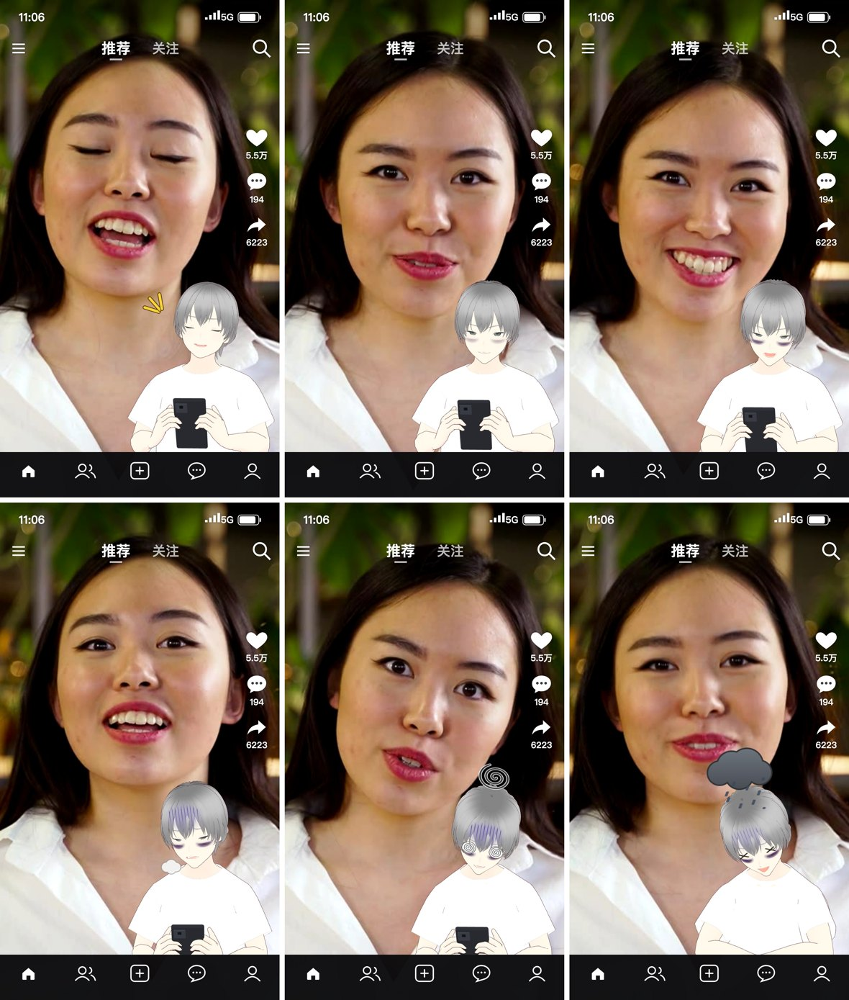
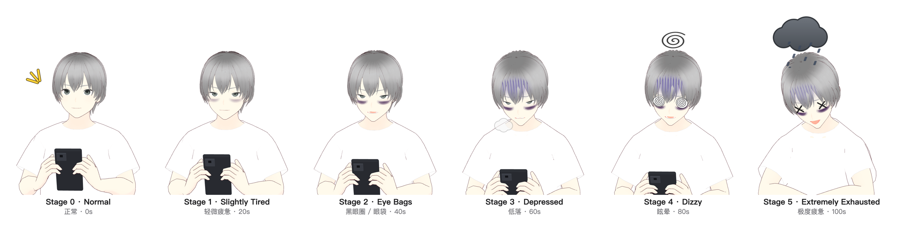
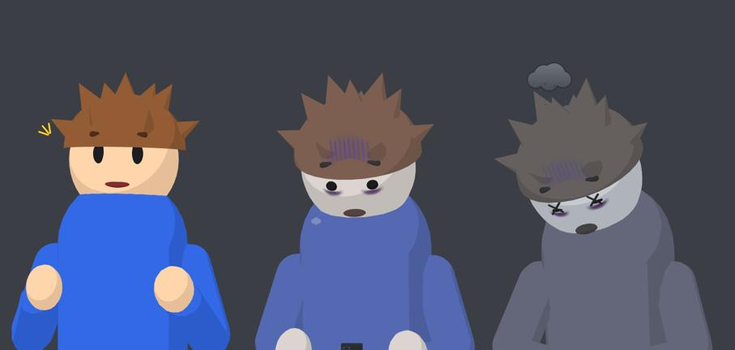
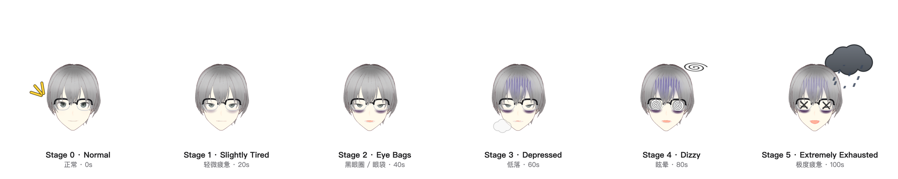

# 05 验收记录

需求文档要求“每完成一个阶段就运行和测试”。本文记录各阶段按什么标准、用什么方法验证，以及结果。所有测试都在开发电脑上进行，没有真人坐在摄像头前。摄像头画面来自 Chrome 的虚拟摄像头，播放一段人脸视频。

测试环境：macOS，Apple M1 Pro，Chrome 157（headless，WebGL 走 Metal），Node.js 26.8.1。

## 自动化测试

| 测试 | 命令 | 结果 |
|---|---|---|
| 类型检查 | `npm run typecheck` | 通过 |
| 单元测试 | `npm test` | 8 个文件、32 项全部通过（第一轮交付时为 7 个文件、25 项） |
| 端到端自检 | `npm run check:e2e -- --video 说话视频.mjpeg` | 26 / 26 项通过（第一轮为 19 项，第二轮新增 7 项版本 A / B 检查）；不带人脸视频时 21 / 21 项通过 |
| 生产构建 | `npm run build` + `npm run preview` | 页面正常，模型加载、面捕可用，无请求失败 |

单元测试覆盖：计时器（开始、暂停、跳转、重置）、阶段计算与时间表校正、叠加规则（每一级都验证用户眨眼能让角色完全闭眼、张大嘴能继续张开）、One Euro 滤波、镜像与眨眼重映射、头部姿态正负号、校准、ARKit 名称匹配、材质分组、六级参数的整体趋势，以及默认模型包含 52 个 ARKit 表情和全部所需骨骼。

## Phase 1 基础网页与摄像头

验收标准：浏览器能够稳定显示摄像头画面，用户可以主动开启和关闭。

| 检查 | 结果 |
|---|---|
| 点击 Start Camera 后申请权限并显示画面 | 通过（虚拟摄像头 1280×720） |
| Stop Camera / 快捷键 C 关闭摄像头，轨道全部停止 | 通过 |
| 9:16 竖屏画面，桌面端居中显示，手机宽度下画面占满屏宽 | 通过（1500×940 桌面视口与 390×844 手机视口截图检查） |
| 没有摄像头设备时给出中文提示 | 通过（“没有找到可用的摄像头……”） |
| 权限被拒、设备被占用、非 HTTPS 时的提示 | 代码中已分别处理，未逐一实测 |

## Phase 2 3D Avatar 与面捕

验收标准：用户做出基础面部动作时，Avatar 能够同步响应。

| 检查 | 结果 |
|---|---|
| 加载测试 VRM | 通过，52 个 ARKit 通道全部直连 |
| 人脸检测与帧率 | 通过，GPU 模式，面捕 30 fps（等于摄像头帧率），每帧 11–14 ms，渲染 60 fps |
| 张嘴驱动 | 通过，说话视频中 jawOpen 变化幅度 0.46 |
| 眨眼驱动 | 通过，eyeBlink 变化幅度 0.93 |
| 头部转动 | 通过。转头视频中人物转向自己左侧，镜像画面里朝向屏幕左边，角色同向转动，yaw 达到上限 -55°；转成侧脸后人脸丢失，角色平滑回到中性姿态 |
| 平滑处理 | 通过，One Euro 滤波，单元测试验证去抖与跟随速度 |
| Avatar 在右下角、半身、无头像框、背景透明 | 通过，Avatar 区域贴右边缘，透明像素检查左上角 alpha = 0 |
| 模块化 | 面捕、计时、疲惫、模型加载分别在 `src/tracking/`、`src/fatigue/`、`src/avatar/`，通过数据接口连接 |

上图从左到右、从上到下为 Stage 0–5，画面中的人物来自 Pexels 免费视频（编号 8048249），只用于测试。参考图见 [reference_layout.png](media/reference_layout.png)。

## Phase 3 六级疲惫动画

验收标准：可通过计时或手动切换看到六个明显区分的状态。

| 检查 | 结果 |
|---|---|
| 可配置计时器 | 通过。把时间表临时改为 0/1/2/3/4/5 秒，计时开始后依次进入 Stage 0–5；暂停后时间不再增加 |
| 手动切换 | 通过。按 0–5 立即进入对应阶段并保持；Auto 回到跟随计时；拖动时间轴跳到对应阶段 |
| 六个状态明显区分 | 通过，见下图 |
| 疲惫动画与面捕叠加 | 通过。用说话视频作摄像头，各阶段最终眨眼值都不低于眼皮下垂下限，用户眨眼时能升到 0.96–1.00；张嘴同理（数据见 [04 疲惫动画实现说明](04_疲惫动画实现说明.md)） |
| 重置 | 通过。计时归零，角色立即回到 Stage 0 |

这张图由面板的“导出六阶段立绘”直接生成。需求文档中的参考图见 [reference_six_stages.png](media/reference_six_stages.png)。

## Phase 4 替换个人角色

验收标准：新角色能正常面捕，六级疲惫效果可用。

研究者尚未提供自己的角色模型，这一阶段完成的是替换接口和检查工具，并用五种情况做了测试：

| 测试模型 | 结果 |
|---|---|
| PS_Female.vrm（第二个测试模型） | 52 个通道直连，六阶段正常 |
| 去掉 52 个 ARKit 表情、只剩 VRM 预设的变体 | 直连 0、回退 22、缺失 30；眨眼、张嘴、眉毛（经 sad / angry）、视线（经 LookAt）可用，六阶段正常，提示“不是 Perfect Sync，已启用预设表情回退”“没有 tongueOut” |
| 去掉 VRM 扩展的普通 GLB（VRoid 骨骼命名） | 骨骼按名称识别成功，自动检测到面朝 -Z 并旋转 180°，52 个 Morph Target 直连，六阶段正常 |
| Mixamo 骨架的 GLB（three.js 示例 Xbot，无面部表情） | 骨骼识别成功；提示无表情、无皮肤材质；头部动作、调色、头顶符号、按眼球骨骼定位的眼部符号可用 |
| 不存在的文件 | 提示“找不到模型文件……”，并换成内置占位角色 |

测试中发现并修复了四个问题：普通 GLB 的朝向；多个 primitive 共用顶点缓冲导致眼睛范围测量错误；骨架带 0.01 缩放时贴片变得极小；开发服务器对不存在的文件返回网页，导致报错信息写成“解析失败”，实际应为“找不到文件”。

研究者拿到自己的模型后，按 [02 模型替换说明](02_模型替换说明.md) 的步骤 7 再验收一次。

## Phase 5 研究展示版本

验收标准：可重复运行、重置、切换状态，并录制完整演示。

| 检查 | 结果 |
|---|---|
| 录制 | 通过。MP4（H.264），1080×1920，约 30 fps，码率约 12 Mbps |
| 截图 / 角色透明 PNG / 六阶段立绘 | 通过 |
| 演示模式（H 隐藏面板） | 通过 |
| 连续运行 3 分钟 | 通过。摄像头开启、计时器循环三轮 Stage 0–5，渲染 57–60 fps，面捕 30 fps、每帧 13–16 ms；JS 堆内存在 82–111 MB 之间波动，没有上升趋势；无页面错误 |
| 设置保存 | 通过。阶段时间、过渡时间、布局、面捕参数、贴片微调改动后刷新页面，数值保留（校准值走同一套保存逻辑） |

## 第二轮修改（2026-11-13）

修改意见见 [07 版本 B 头部叠脸说明](07_版本B头部叠脸说明.md)。验收按三条意见分别检查。

| 检查 | 结果 |
|---|---|
| 版本 A 从 Stage 0 起举着手机 | 通过。端到端自检确认 Stage 0 时手机可见；六阶段立绘见下图 |
| 版本 B 只画头部 | 通过。测试模型 7 块身体网格中隐藏 6 块，剩下的脖子皮肤由下巴下方的裁切平面去掉；手机隐藏 |
| 版本 B 头部跟随人脸 | 通过。说话视频中头部按用户脸宽缩放、下巴对齐，用户的眼睛和下巴都落在头部画面内；转头视频中头部跟着转，转成侧脸后淡出，转回正面后淡入 |
| 摄像头开着但没有人脸 / 摄像头关闭 | 通过。前者头部隐藏，后者头部放在画面中央 |
| 两个版本界面尺寸一致 | 通过。两个版本共用 1080×1920 合成画布、短视频界面和控制面板；来回切换 A → B → A 后身体、手机、裁切都恢复 |
| 地址栏参数 `?version=B` | 通过 |
| 版本 B 导出六阶段头像 | 通过 |
| 版本 B 帧率 | 渲染 58–60 fps，面捕 30 fps、每帧约 14 ms（测试电脑同上） |
| 版本 B 连续运行 3 分钟 | 通过。摄像头开启、计时器循环三轮 Stage 0–5，渲染 56–60 fps，面捕 30 fps、每帧 13–18 ms；JS 堆内存在 80–105 MB 之间波动，没有上升趋势；无页面错误 |

版本 B 另用五种模型测过：

| 模型 | 隐藏的身体网格 | 下巴 | 结果 |
|---|---|---|---|
| PS_Female.vrm | 6 | 测得 | 正常 |
| 只有预设表情的 VRM 变体 | 6 | 测得 | 正常 |
| 去掉 VRM 扩展的普通 GLB | 6 | 测得 | 正常 |
| Mixamo Xbot.glb（整个角色一个网格） | 0 | 测得 | 只靠下巴裁切去掉身体，头部正常摆放；模型检查给出相应提示 |
| 内置占位角色 | 8 | 测得 | 正常 |

开发版本 B 时发现并改掉了三个问题。一开始按“眼睛到下巴”的距离缩放，动漫角色的头大到占满画面，改为按脸宽缩放、下巴对齐。平面裁切去不掉下颌两侧的脖子，改为先隐藏身体网格。近景时头顶符号被画面边缘截断，改为把符号挪到头部右上方，并让版本 B 的自动构图留出更多空间。

## 尚未验证的部分

- 真人对着真实摄像头的效果。所有面捕测试都用视频文件代替摄像头；真实使用时的光线、距离、戴眼镜等情况，需要研究者亲自试一遍，必要时调“眨眼起点 / 终点”和“校准正脸”。
- Safari、Firefox、Windows 电脑、真实手机。代码使用的都是标准 Web API，但没有在这些环境里实际运行。Safari 的录屏格式可能与 Chrome 不同。
- 低配置电脑上的性能。调试面板会显示帧率和每帧耗时，可据此判断。
- 长时间（30 分钟以上）连续运行。
- 研究者自己的角色模型（尚未提供）。
- 版本 B 在真实距离下的效果。测试视频都是近景，脸几乎占满画面；真实使用时人坐在一臂远处，头部和符号在画面中的比例需要实测确认。戴眼镜、刘海较长、脸型差异较大的用户也没有测过。
