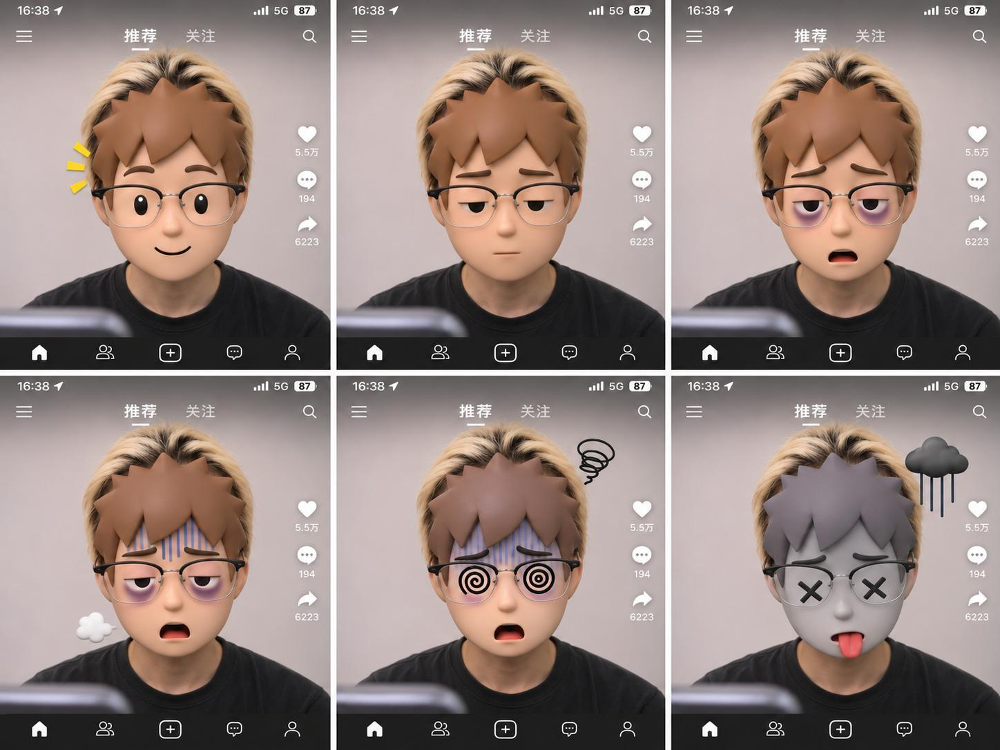
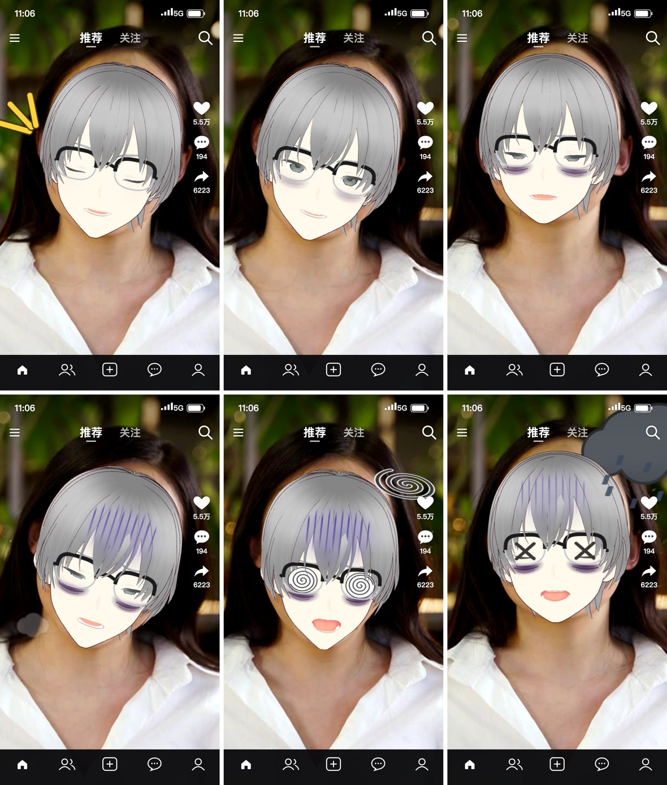
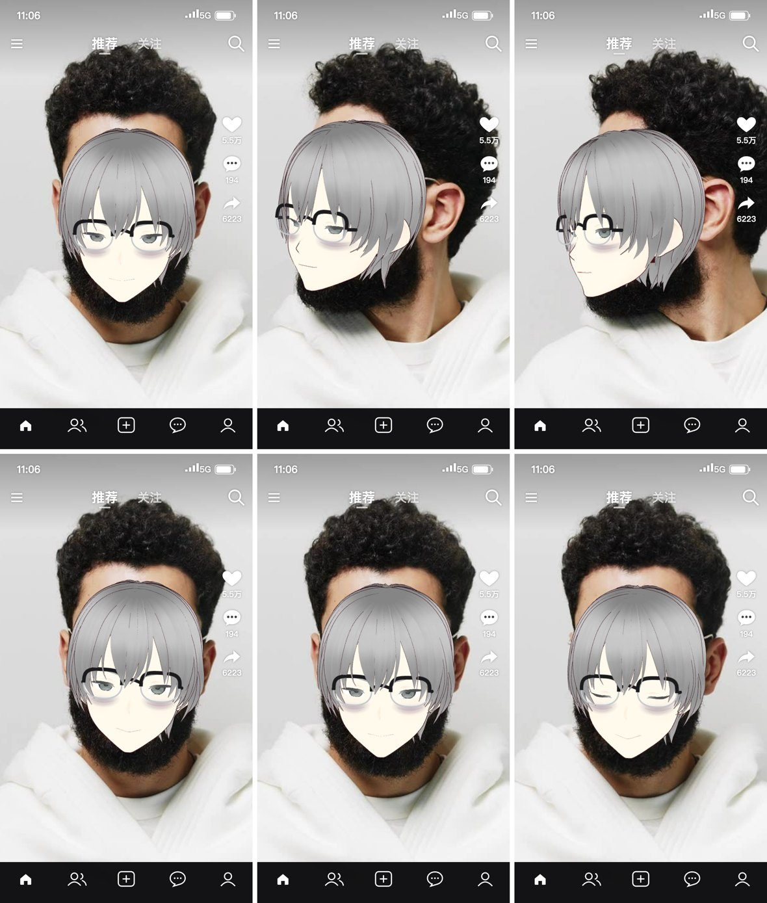

# 07 版本 B：头部叠在脸上

## 第二轮修改意见

2026-11-13 收到的修改意见（`顾静论文/需求.pdf`）有三条：

1. 尝试做另一个版本：Avatar 只有头部，叠在用户脸上，其他地方不遮住，让用户更能认出是自己。
2. 现有版本在进程到 Stage 1 时 Avatar 才举起手机，改成从一开始就举着手机。
3. 两个版本的界面尺寸保持一致。

第 2 条改在版本 A 上：`src/fatigue/stages.ts` 中 Stage 0 的手臂姿势由“双拳在胸前”改为“举手机”，精神线和微笑保留。第 1 条对应本文的版本 B。第 3 条靠两个版本共用同一个程序实现：合成画布同为 1080×1920，短视频界面和控制面板也是同一套，只有 Avatar 的画法不同，所以尺寸一致。

修改意见中的效果图：

本原型的实现（测试模型，摄像头画面来自测试视频）：

## 和版本 A 的区别

| 项目 | 版本 A | 版本 B |
|---|---|---|
| Avatar 渲染 | 半身，画在右下角固定区域 | 只有头部，单独渲染后贴到用户脸上 |
| 身体和手机 | 显示 | 隐藏 |
| 疲惫姿态（低头、歪头、前倾、塌肩、趴下） | 使用 | 不用；Stage 4 的眩晕摇晃保留 40% |
| 自动大脸构图 | 脸高约占画面 40% | 约 30%，留出肩膀和符号的位置 |
| 旋涡、乌云 | 头顶正上方 | 头部右上方（用户自己的头发在角色头部上面） |
| 眼镜 | 默认不戴 | 默认戴 |

两个版本的表情、黑眼圈、调色、额头竖线、螺旋眼、× 眼、精神线和叹气符号相同，计时器、阶段时间和疲惫参数也共用一套。

## 只留下头部

程序分两步去掉头部以外的部分。

第一步，隐藏身体网格。每个顶点按权重最大的骨骼归类，看它属于 head 骨骼本身还是 head 下面的子骨骼（头发、眼球骨骼都挂在 head 下面）。属于头部的顶点不到 5% 的网格算作身体，在版本 B 中隐藏。测试模型的身体被拆成 7 块网格，其中 6 块（身体皮肤、上衣、裤子、鞋）被隐藏。剩下一块是脖子附近的皮肤，有一部分顶点绑在头上，交给第二步处理。脸、眼睛、眉毛、睫毛、嘴和全部头发保留。整个角色只有一个网格时（例如 Mixamo 的 Xbot），不隐藏任何网格，只靠第二步。

第二步，在下巴下面裁切。模型加载时，程序沿面部中线从眼睛往下逐行打射线，步长 3 毫米。命中点突然向后跳 2 厘米以上（越过下巴落到了脖子上），或者不再命中时，上一行就是下巴。测试模型的下巴测得在眼睛下方约 10 厘米。裁切平面放在下巴下方 6 毫米，跟着头部一起转动，平面以下的部分不画。测不到下巴的模型按比例估算，并在模型检查里给出提示。

## 贴到用户脸上

头部单独渲染到一张 1024×1024 的透明画布上，镜头正对头部。面捕得到的转头、点头、歪头全部加在 head 骨骼上，所以画布里的头已经朝着和用户一样的方向。这张画布经过平移和缩放后画进合成画面，位于摄像头画面之上、短视频界面之下。平移和缩放的算法如下。

用户这边用 MediaPipe 的五组关键点（平滑后）：双眼四个眼角的平均点、下巴（152 号点）、脸部左右轮廓（234、454 号点）。它们先换算到合成画布的像素坐标，裁切和镜像都与摄像头画面一致。

缩放按脸宽：用户脸宽取左右轮廓两点的三维距离（含深度，转头时基本不变），角色脸宽取下巴到眼睛之间、头部前半部分的皮肤左右范围（不含耳朵）。两者之比再乘以“头部大小”（默认 0.92），就是头部画布的缩放倍数。

位置按下巴：角色的下巴对齐用户闭嘴时的下巴。程序在用户闭嘴（jawOpen 小于 0.12）时持续记录“眼睛到下巴的距离 ÷ 脸宽”，时间常数约 2 秒。摆放时沿当前“眼睛 → 下巴”的方向取这个长度。说话时下巴关键点会往下移，但这个长度不变，所以头部不会跟着嘴上下跳；低头、抬头造成的透视缩短仍然保留。

没有按眼睛对齐，因为动漫角色眼睛大、下巴短。最初按眼睛对齐、按“眼睛到下巴”的距离缩放，结果测试模型的头大到占满整个画面。改成按脸宽缩放、下巴对齐后，头的大小接近用户的头，用户自己的下巴也不会从角色下巴下面露出来。代价是角色的眼睛比用户的眼睛略低，用户的眼睛被角色的刘海挡住，画面上看不出来。

摄像头关闭时，头部放在画面中央偏上，方便预览和截图。摄像头开着但没有检测到人脸时（例如转成侧脸），头部随面捕可信度淡出，露出用户自己的脸；重新检测到人脸后再淡入。

## 眼镜

效果图中的头像戴着和用户一样的眉线框眼镜。程序给角色加了一副自己生成的眼镜：上框粗黑、下框细银，带鼻梁和镜腿，大小和位置按测得的眼睛自动计算，跟着头部转动，不参与疲惫调色。版本 B 默认戴，版本 A 默认不戴，在“角色 Avatar → 角色戴眼镜”中两个版本分别开关。

用户本人的眼镜会被角色头部盖住。如果研究者自己的角色模型本来就带眼镜，把这个开关关掉即可。

## 调节

| 想调什么 | 在哪里 |
|---|---|
| 头部整体大小 | “角色 Avatar → 头部大小”（默认 0.92） |
| 头部位置 | “角色 Avatar → 上下偏移 / 左右偏移”，单位是用户脸宽 |
| 黑眼圈、螺旋眼、× 眼的位置，头顶符号的高度和大小 | “贴片微调”，两个版本通用 |
| 眼镜 | “角色 Avatar → 角色戴眼镜” |

用户坐得离摄像头很近、脸本来就占满画面时，自动构图无法再缩小画面（不会显示摄像头视野以外的区域），这时头部和旁边的符号会显得很大，部分符号可能被画面边缘或右侧图标挡住。坐远一些，让脸在摄像头画面里占三分之一左右，效果最接近效果图。

## 已知限制

- 头部的转动由三维渲染完成，位置和大小是在二维画面上对齐的。头部转到接近侧脸时，MediaPipe 检测不到人脸，头部会淡出。
- 动漫角色与真人比例不同，角色眼睛会比用户眼睛略低，较宽的头发可能盖住用户的耳朵。研究者自己的角色比例接近真人时，这两点会减轻。
- 用户的真眼镜和刘海不会叠在角色上面。要做到这一点需要对摄像头画面做分割，本原型没有做。
- 长头发的角色在下巴下方被截断。

## 验证

- 端到端自检（`npm run check:e2e`）新增 7 项（共 26 项）：版本 A 的 Stage 0 举着手机；切到版本 B 后身体网格和手机隐藏、裁切生效；默认戴眼镜；头部跟随人脸摆放；用户的眼睛和下巴都在头部画面范围内；导出六阶段头像；切回版本 A 后身体恢复。没有人脸视频时，改为检查“摄像头开着但没有人脸时头部隐藏”和“摄像头关闭时头部居中”。
- 单元测试新增 7 项（共 32 项）：头部摆放 5 项（默认位置、按脸宽缩放并对齐下巴、张嘴时头部不动、镜像、大小与偏移），闭嘴时的下巴比例校准 1 项，版本 A 从 Stage 0 起举着手机 1 项。
- 另用女性测试模型、只有预设表情的 VRM、普通 GLB、Mixamo 的 Xbot 和内置占位角色分别跑了版本 B，头部都能正确分离和摆放（见 [05 验收记录](05_验收记录.md)）。
